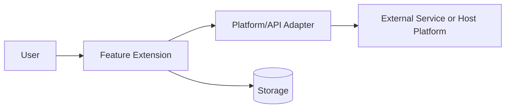

# Development Plan Template

## 1. Executive Summary

- Extension name:
- Goal:
- Primary users:
- Business/product value:
- Recommended delivery path:

## 2. Scope

### In scope

- 

### Out of scope

- 

### Assumptions

| Assumption | Impact if wrong | Validation method |
|---|---|---|
|  |  |  |

## 3. Research Summary

| Topic | Finding | Source quality | Impact |
|---|---|---|---|
| Platform/API constraints |  | Official / primary / secondary |  |
| Permissions/review policy |  | Official / primary / secondary |  |
| Comparable implementation |  | Official / primary / secondary |  |
| Security/privacy guidance |  | Official / primary / secondary |  |

## 4. Requirements

### Functional requirements

| ID | Requirement | Priority | Acceptance signal |
|---|---|---:|---|
| FR-001 |  | Must |  |

### Non-functional requirements

| ID | Requirement | Target | Validation |
|---|---|---|---|
| NFR-001 | Performance |  |  |
| NFR-002 | Security |  |  |
| NFR-003 | Privacy |  |  |
| NFR-004 | Accessibility |  |  |
| NFR-005 | Maintainability |  |  |

## 5. Architecture Proposal

### System context

### Module boundaries

| Module | Responsibility | Depends on | Exposes |
|---|---|---|---|
| Domain | Core rules and workflows | Abstractions only | Use cases, entities, policies |
| Application | Orchestration and commands | Domain ports | Command/query handlers |
| Adapters | Platform/API/storage implementation | External SDKs/APIs | Port implementations |
| UI | User interaction | Application services | Screens/components/actions |

### SOLID notes

| Principle | Design application | Coupling avoided |
|---|---|---|
| SRP |  |  |
| OCP |  |  |
| LSP |  |  |
| ISP |  |  |
| DIP |  |  |

## 6. Pseudocode and Schemas

Include only the pseudocode and schemas necessary to guide implementation.

## 7. Development Phases

| Phase | Goal | Workstreams | Output | Gate |
|---|---|---|---|---|
| 0 | Discovery and validation | Research spikes | Validated constraints | Architecture signoff |
| 1 | Foundation | Contracts, project structure, CI | Buildable skeleton | CI green |
| 2 | Core feature | Domain/application/UI | MVP behavior | Acceptance tests pass |
| 3 | Hardening | Security, QA, observability | Production candidate | Release readiness |
| 4 | Rollout | Deployment, monitoring, support | Released extension | Post-release review |

## 8. TPM / Engineering Handoff

Use the handoff template in `05_handoffs/05_tpm_development_team_handoff_template.md`.