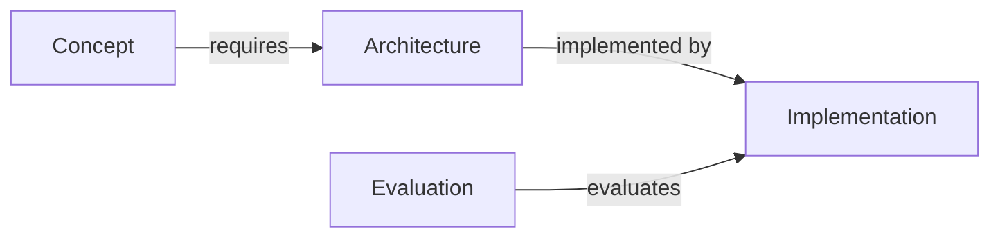

# 25 Templates Evidence And Dependencies

This is an indexed consolidation of the original v2 package. Section headers preserve original source paths. Follow core instructions over illustrative examples.

---

## Original source: `05_templates/07_claim_to_source_ledger.md`

# Claim-to-source ledger — {{topic}}

A source citation is not enough: link each consequential claim to the exact source content and setting.

| Claim ID | Proposed wording | Evidence class | Source + version/date | Verified section/figure/API | Applicable conditions | Counterevidence | Review status | Affected Atlas paths |
| --- | --- | --- | --- | --- | --- | --- | --- | --- |
| {{id}} | {{claim}} | {{primary_supported / engineering_inference / hypothesis / ...}} | {{source}} | {{location}} | {{preconditions}} | {{disagreement}} | {{verified / partially / not}} | {{paths}} |

## Review protocol
- Read supporting section, not just abstract. Check model version, dataset, sample count, and measurement definition.
- For vendor claims, record model/API version and check date.
- For negative findings, record whether baseline and conditions are comparable.
- If no direct source supports a claim, rewrite as a hypothesis or remove it.

---

## Original source: `05_templates/08_conflicting_evidence_review.md`

# Conflicting evidence review — {{topic}}

**Claim under dispute:** {{claim}}

| Dimension | Source A | Source B | Assessment |
| --- | --- | --- | --- |
| Date/model/dataset | {{a}} | {{b}} | {{comparable?}} |
| Metric and protocol | {{a}} | {{b}} | {{compatible?}} |
| Settings/resources | {{a}} | {{b}} | {{fair?}} |
| Results | {{a}} | {{b}} | {{direct support?}} |
| Limitations | {{a}} | {{b}} | {{bias?}} |

**Conclusion class:** resolved in context / unresolved contradiction / insufficient evidence.
**Safe Atlas wording:** {{qualified statement}}
**Experiment that could disambiguate:** {{testable hypothesis, baselines, costs, acceptance}}

---

## Original source: `05_templates/09_typed_dependency_map.md`

# Typed knowledge and workflow dependency map — {{request_id}}

Each node is an exact Atlas path, a proven external reference or `proposed:<topic>`. Do not invent current paths.

| From | Relationship | To | Rationale | Evidence state |
| --- | --- | --- | --- | --- |
| {{canonical_path}} | requires / implements / evaluates / constrains / data_flows_to / control_flows_to | {{path}} | {{why}} | {{verified / inferred}} |

## Conceptual dependency graph

## Runtime flow (only if relevant)
{{separate data flow, control flow, evidence provenance and authorization boundaries}}

## Missing prerequisites and incorrect assumptions
{{blocking/optional; parent links to update}}
