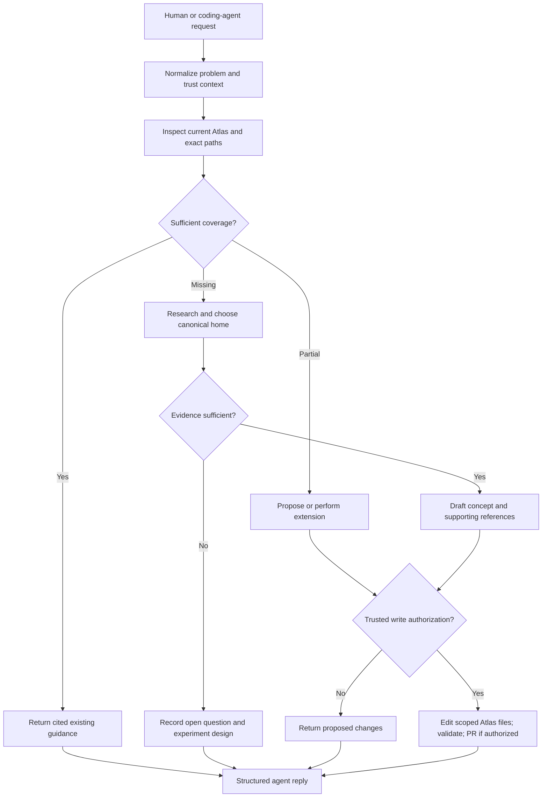

# 27 Workflow Intake And Retrieval

This is an indexed consolidation of the original v2 package. Section headers preserve original source paths. Follow core instructions over illustrative examples.

---

## Original source: `06_workflows/01_request_routing.md`

# Workflow — Knowledge request router

## Paths
- Lookup: usually read-only; immediate exact references, no PR.
- Targeted audit: investigate stated missing/weak concepts; gap matrix.
- Deep research: bound scope, note evidence categories, plan multi-batch review.
- Documentation: minimal changes on a verified branch; catalog and cross-links.
- Implementation: only when truly warranted; enforce separate code/test labels.
- Evaluation: reproducible design by default; measured results only after runs.

Important: a research request is not permission to run background work autonomously. No "queued" or "running" claims without a real executor and an actual task status.

---

## Original source: `06_workflows/05_just_in_time_lookup.md`

# Workflow — Narrow coding-agent knowledge lookup

**Objective:** Small requests get small answers; full repo rebuilding is unnecessary.

**Why:** Small requests get small answers; full repo rebuilding is unnecessary.

## Steps
1. Normalize question, scope and revision.
2. Resolve exact path/alias through existing README and repository search.
3. Inspect the most relevant canonical page.
4. If sufficient, answer with precise path, source caveat and application constraints.
5. If partially covered, point to missing subsections and propose targeted extension.
6. Return structured disposition without write side effects unless specifically approved.

## Exit artifact
Source-grounded answer, source path(s), confidence and next step.

## Failure guard
An agent saying "missing" is a hypothesis, not permission for duplicate creation.

---

## Original source: `06_workflows/10_retrieval_and_context_budget.md`

# Workflow — Evidence selection under limited context

**Objective:** Keep agent context small without trusting opaque summaries.

**Why:** Keep agent context small without trusting opaque summaries.

## Steps
1. Resolve user/caller intent and target source paths.
2. Read index and high-signal canonical sections.
3. Retrieve exact, versioned passages with source IDs.
4. If uncertain, escalate to longer sections, original media, specialist methods or independent sources.
5. Cache only compatible, authorized and provenance-linked results.
6. Return answers with limitations instead of filling unsupported gaps from memory.

## Exit artifact
Minimal cited context packet and escalation conditions.

## Failure guard
Embedding proximity does not imply entailment, authoritative path or access rights.
